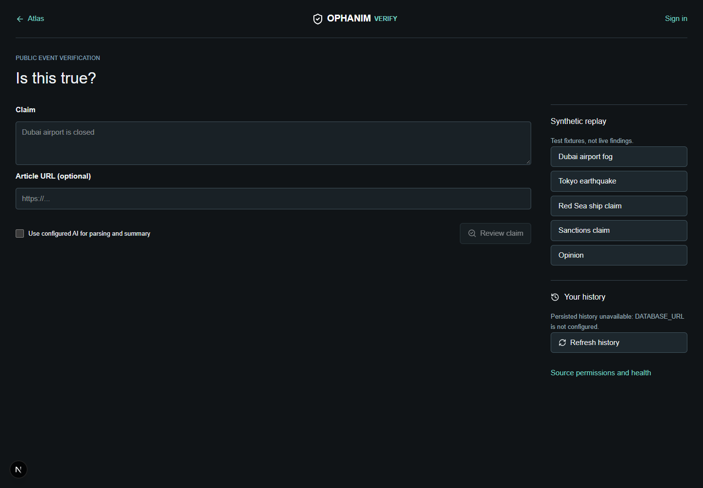
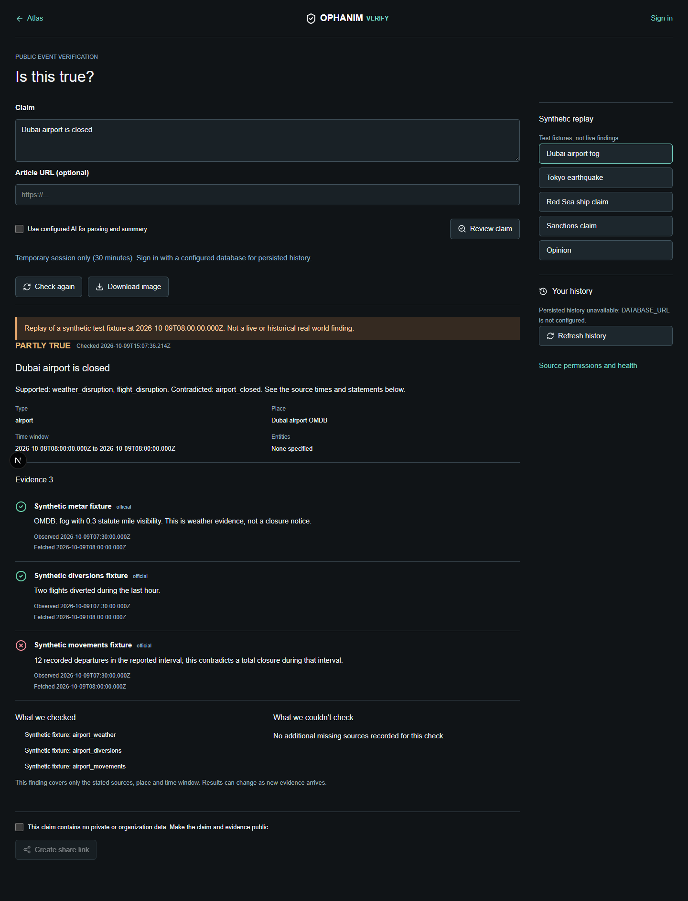
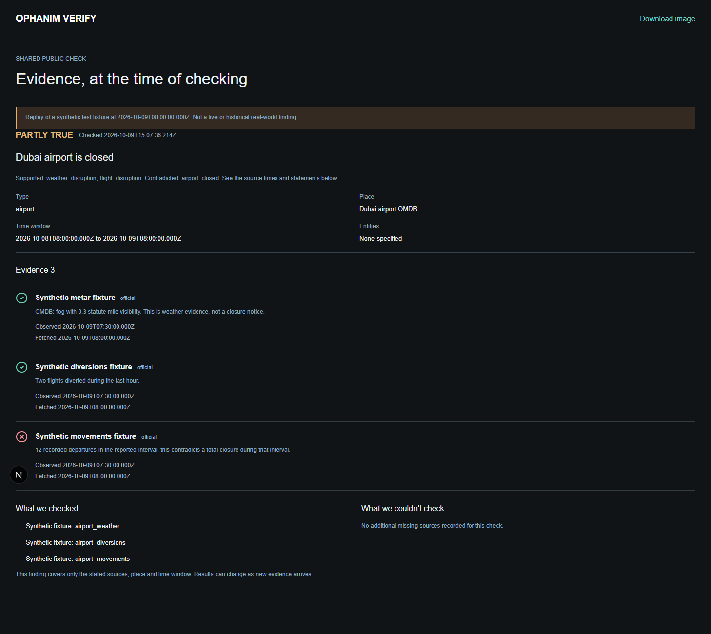
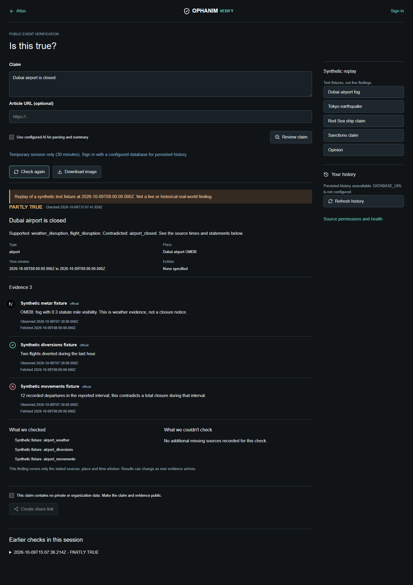
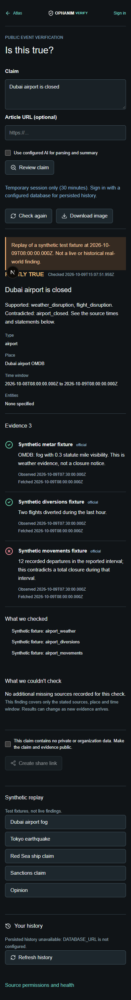

# Milestone 0: Ophanim Verify Report

9 October 2026. Starting application revision `6f8523b`; preflight record `ef2ca4a`.

## Status

Verify's public-event input, review, deterministic checker flow, evidence UI,
optional AI helpers, synthetic rehearsal cases, share/image/revocation and
history storage code are implemented. Live coverage remains bounded and source-
dependent. This is not a claim that all requested live airport, maritime, sanctions
and general-news integrations are operational.

**RLS baseline: not available**

The founder authorized proceeding without a database/RLS baseline. No production
database was created, modified or seeded. Both new organization tables have
additive RLS migrations and a live integration test that skips without
`DATABASE_URL` and exercises real database policies when it is set.

Milestones A-E, optional OCR and natural-language watches were not implemented in
this milestone. No World Monitor source/API/embed was used. Existing globe,
feeds, searches, logistics workflows and basemaps were preserved.

## Built

- `/verify`: text/optional URL input; editable claim type, place, coordinates,
  airport code, time and entities; explicit confirmation before live checking.
- Fixed provider allowlists through the existing normalized intelligence registry.
  Empty allowlists do not accidentally query every provider. Invalid source
  configuration and source failures are isolated.
- Rules for earthquakes, airport closure/disruption, storms/floods, wildfire,
  maritime events, sanctions and trusted news. Opinions/predictions are uncheckable;
  conservative personal-claim checks decline private allegations.
- Source/observation/fetch times, supports/contradicts/neutral evidence, explicit
  unavailable coverage, a fixed verdict and optional separate INFERENCE summary.
- Bounded URL text retrieval with redirect/DNS SSRF checks and socket IP pinning.
  Article text/hash/fetch time stay private and do not constitute independent proof.
- Owner/organization-filtered history, immutable prior re-check records, composite
  cross-tenant foreign keys. Client Data API access cannot insert verdicts.
- Opt-in, token-hashed, expiring, revocable public snapshots; PNG evidence exports.
- Explicit 30-minute no-database fallback for current checks and temporary shares,
  never displayed as database persistence. Shared snapshot whitelist excludes
  organization/user metadata, article text, keys and previous-run IDs.
- Five labelled synthetic replay cases and offline tests. Replays are not falsely
  presented as recorded real-world findings or automatically substituted for live.
- Atlas entry links; Verify source permissions in admin/health. Page-specific
  scrolling fixes do not change the globe's full-screen layout.

## Checks Before And After

| Check | Before | After |
| --- | --- | --- |
| `npx tsc --noEmit` | pass | pass |
| `npm test` | 50 files; 153 passed, 1 skipped | 57 files; 211 passed, 2 skipped |
| Focused lint | pass | pass, no errors/warnings in new Verify files and registry changes |
| `npm run build` | default cache EPERM; isolated build passed, 96 static pages | isolated build passed, 101 static pages |
| RLS baseline | not available | live Verify test skipped; static migration assertions passed |
| Browser end-to-end | no Verify UI | passed, desktop 1440x1000/mobile 390x844, no page errors |
| Live source check | not run for Verify | live USGS result: HTTP 200, CONFIRMED, one matching evidence item from 13 observations |

The live USGS run checked public record `us6000u15x` against its reported location,
magnitude and the last 24-hour window. This was a real live-mode API test, distinct
from the synthetic replay screenshots. Source availability/data can change.

Build command on this Windows/OneDrive workspace:

```powershell
$env:NEXT_DEV_DIST_DIR='.next-verify-build'
npm run build
```

The normal `.next` build initially failed with an EPERM unlink lock. It was not
silenced or fixed by deleting caches; a separate build directory completed.
Next's generated tsconfig cache-path edits were removed after verification to
avoid unrelated configuration churn. The dev server uses `.next-verify-ui`.

Focused lint command:

```bash
npx eslint src/lib/verify src/components/verify src/app/verify src/app/api/verify src/lib/intelligence/event-provider.ts src/lib/intelligence/event-provider-registry.ts
```

No whole-repository lint-clean claim is made. Existing lint findings in atlas and
HealthDashboard were not refactored. Existing Vite configuration-loader warnings
remain. npm install reported 12 audit findings; no unrelated dependency upgrades
or force fixes were performed.

Tests cover every checker/verdict path, unknown observations, exact entity/code
matching, time/magnitude bounds, private records, URL protocols/private addresses,
redirects, DNS-IP pinning, size/time limits, publisher independence, source failure
isolation, licence gating, AI-only inference, ownership, snapshot privacy, share
expiration/revocation, body limits, cross-origin mutations and IP/user rate limits.
The live DB test requires existing migrations and an appropriate non-production
test role; it rolls back fixture data. It does not silently connect to or migrate
an unrelated database.

## Source Permissions

| New source | Licence | Commercial use | Attribution | Rate limits / credentials | Default |
| --- | --- | --- | --- | --- | --- |
| NOAA Aviation Weather METAR | NWS public domain; third-party/international reports require review | unknown, operator review required | NOAA/NWS Aviation Weather Center; no endorsement; Ophanim interpretation | 100/min upstream; 5/min per process, 60s cache; no key | off |
| Operator-configured public observations | unknown until explicitly supplied | unknown until reviewed terms/attribution supplied | required operator-supplied text | 5/min per process, public bounded endpoint; no key in this adapter | off |

Existing USGS/NASA EONET/official sanctions event providers are reused. Existing
provider defaults were not changed. New query-only providers are off when
commercial status is unknown/no; warnings are visible in the registry and
Verify health section. Complete source/attribute configuration and primary terms
links are in [VERIFY_RULES.md](VERIFY_RULES.md).

## Acceptance Limits / Founder Decisions

- Synthetic Dubai fog produces PARTLY TRUE, with weather/diversions support and
  twelve fixture departures contradicting total closure. This is not real DXB
  flight history. Live DXB movements/official closure sources still need a
  compliant configured feed.
- A live USGS earthquake produced CONFIRMED; absence/failures produce uncertainty.
- AIS gaps do not prove seizures/attacks. UKMTO/official incident and movement
  observations are not automatically connected by this milestone.
- EONET is checked for available hazards. GDACS forecast cones, FIRMS detections,
  TAF forecasts and additional named sanctions APIs are not connected to Verify.
- General news requires reviewed public observations, source tiers and independence
  groups; the existing general RSS stream is not automatically treated as proof.
- Persisted signed-in history, durable multi-instance sharing and live RLS
  isolation were not acceptance-tested without a database. Their code/migrations
  exist; the missing integration test is skipped, not passed.
- AI behavior is mock-tested. No paid AI request or live local-model connection
  was made in this milestone. The existing configurable provider is reused.
- Abuse checks are conservative heuristics, not exhaustive personal-claim
  moderation. Shared-claim consent cannot automatically detect all sensitive text.
  Public production deployment needs moderation and a shared multi-instance limiter.
- Temporary shares are filesystem-backed, single-instance and explicitly expiring.
  Use the database-backed authenticated path for durable production operation.
- Replay fixtures are synthetic, not historical network recordings. A real-world
  archived demo dataset requires sourced captures and permission to retain them.

## Screenshots











The history screenshot documents a session comparison plus the explicit missing
database notice. It is not evidence of a successful persisted-history/RLS run.

## Exact Changed Files

The list below is the milestone's source, migration, test and artifact inventory.

- `README.md`
- `db/migrations/024_verify.sql`
- `docs/GAP_MILESTONE_BASELINE.md`
- `docs/VERIFY_MILESTONE_REPORT.md`
- `docs/VERIFY_RULES.md`
- `docs/screenshots/verify/history-session.png`
- `docs/screenshots/verify/input.png`
- `docs/screenshots/verify/mobile.png`
- `docs/screenshots/verify/partly-true.png`
- `docs/screenshots/verify/shared.png`
- `package-lock.json`
- `package.json`
- `src/app/api/verify/check/route.ts`
- `src/app/api/verify/history/route.ts`
- `src/app/api/verify/image/route.ts`
- `src/app/api/verify/parse/route.ts`
- `src/app/api/verify/providers/route.ts`
- `src/app/api/verify/shares/route.ts`
- `src/app/atlas/page.tsx`
- `src/app/verify/page.tsx`
- `src/app/verify/shared/[token]/page.tsx`
- `src/components/platform/HealthDashboard.tsx`
- `src/components/verify/VerifyResultCard.tsx`
- `src/components/verify/VerifySourceHealth.tsx`
- `src/components/verify/VerifyWorkspace.tsx`
- `src/components/verify/verify.module.css`
- `src/lib/intelligence/event-provider-registry.ts`
- `src/lib/intelligence/event-provider.ts`
- `src/lib/verify/ai.test.ts`
- `src/lib/verify/ai.ts`
- `src/lib/verify/checkers.test.ts`
- `src/lib/verify/checkers.ts`
- `src/lib/verify/claim.ts`
- `src/lib/verify/fixtures.ts`
- `src/lib/verify/http.test.ts`
- `src/lib/verify/http.ts`
- `src/lib/verify/image.ts`
- `src/lib/verify/providers.ts`
- `src/lib/verify/rls.integration.test.ts`
- `src/lib/verify/service.test.ts`
- `src/lib/verify/service.ts`
- `src/lib/verify/store.test.ts`
- `src/lib/verify/store.ts`
- `src/lib/verify/types.ts`
- `src/lib/verify/url-fetch.test.ts`
- `src/lib/verify/url-fetch.ts`
- `supabase/migrations/20261009141447_verify_security.sql`
- `test-artifacts/verify-smoke.cjs`
